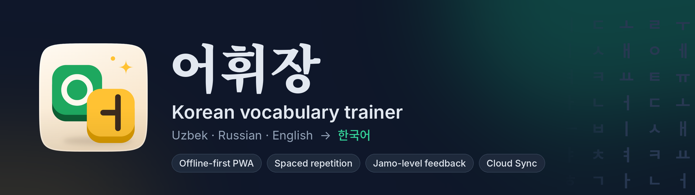

<div align="center">

<a href="https://eohwijang.fyi/"></a>

<br>

[](https://eohwijang.fyi/)
[](https://github.com/Omad-bek/eohwijang/actions/workflows/deploy.yml)


**[Open the app →](https://eohwijang.fyi/)**

[Features](#features) · [Tech stack](#tech-stack) · [Getting started](#getting-started) · [Guides](#guides)

</div>

---

**어휘장** (*eohwijang*, "vocabulary notebook") is an offline-first web app for learning Korean words by **typing them from memory**, unit by unit, alongside the SNU Korean (서울대 한국어) textbooks. You see a prompt in **Uzbek, Russian or English** and answer in **Hangul**. A block of words counts as done only when every word in it is recalled and spelled exactly right.

Most Korean apps stop at recognition flashcards and rarely support Uzbek. 어휘장 is built for exact recall, follows the textbook's structure, and treats all three source languages as equals.

> Independent project — not affiliated with or endorsed by Seoul National University or its publisher.

## Features

**Learning**
- **Typed recall, not multiple choice.** Each word is answered by typing it in Hangul. Missed words come back in later rounds until they are spelled correctly.
- **Jamo-level feedback.** A wrong answer is broken down into its consonant and vowel parts (초성 · 중성 · 종성), so you see exactly which stroke of the syllable went wrong.
- **Spaced repetition.** Every word has a memory level with cooldowns between reviews, and a first-try recall is needed to move up.
- **Textbook structure.** Book → unit → stages of 20–30 words, mirroring the SNU course from 한글 through each 과.
- **Example sentences** with translations you can reveal, plus a **word of the day**.
- **Daily goal, XP and streaks** to keep a study habit going.

**Built for real learners**
- **Uzbek / Russian / English prompts**, or all three at once. The interface language is chosen separately.
- **On-screen 두벌식 keyboard** with real jamo composition on touch devices, and correct IME handling on desktop (no premature checking mid-syllable).
- **Works fully offline** as an installable PWA, which suits commutes and spotty connections.
- **Resume a session.** An unfinished quiz is saved after every answer and can be continued for 30 minutes.
- **Import your own lists** from `.txt`, `.tsv`, `.csv` or `.json`, or paste them in.
- **Light and dark themes**, plus quiet synthesized feedback sounds (Web Audio, no audio files).

**Data and sync**
- **No account needed.** Progress lives in the browser, with one-click JSON backup and restore.
- **Anonymous Cloud Sync** across devices through a random Sync ID. Merges never lose progress.
- **Shared vocabulary** published through a server-verified admin mode, kept strictly separate from each learner's personal data.

## Tech stack

| Area | Tools |
| --- | --- |
| UI | React 18, TypeScript, Tailwind CSS 4, lucide-react |
| Build | Vite 6, `vite-plugin-pwa` (Workbox service worker) |
| Storage | `localStorage` (offline-first), JSON backup and restore |
| Backend (optional) | Supabase Postgres, RPC-only access with no public table reads |
| Deploy | GitHub Actions → GitHub Pages, custom domain [eohwijang.fyi](https://eohwijang.fyi/) |

Under the hood, Hangul decomposition and diffing (`src/utils/hangulDiff.ts`), keyboard composition (`src/utils/hangulInput.ts`) and the spaced-repetition scheduler (`src/lib/srs.ts`) are written from scratch, with no third-party language libraries.

## Project structure

```text
src/
├── components/     UI: Quiz, KoreanKeyboard, Home, Levels, Manager, AdminPanel, CloudSync…
├── lib/            Core logic: srs, sync, storage, books, i18n, activity, soundEngine, theme
├── utils/          Hangul decomposition, jamo diffing and input composition
├── data/           Bundled vocabulary (sample)
├── pages/welcome/  First-run welcome screen
└── design-lab/     Dev-only labs for icons, headers and phone layouts
supabase/           Database schema, RPC functions and example data
scripts/            Icon generation
.github/workflows/  Build and deploy to GitHub Pages
```

Design notes live in [`DESIGN.md`](DESIGN.md) and product goals in [`PRODUCT.md`](PRODUCT.md).

## Getting started

Requires Node.js 20+ (CI uses Node 22).

```sh
git clone https://github.com/Omad-bek/eohwijang.git
cd eohwijang
npm install
npm run dev        # development server
npm run build      # typecheck + production build with service worker (dist/)
npm run preview    # serve the build; install it as an app from the browser
```

The app runs without any backend. Cloud Sync and shared vocabulary are enabled by adding Supabase keys (see [Cloud Sync](#cloud-sync-anonymous)).

## Guides

### Adding the 1A word list

Replace the sample array in `src/data/vocab1A.ts`:

```ts
export const VOCAB_1A: VocabEntry[] = [
  { unit: '한글', ko: '아이', uz: 'bola', ru: 'ребёнок', en: 'child' },
  { unit: '1과', ko: '아래/ 밑', uz: 'past', ru: 'низ', en: 'below' }, // "/" = any form accepted
  // …
];
```

`unit` must be one of `UNITS_1A` (`한글`, `1과` … `8과`). The "sample words" notice on the home screen disappears once 1A has 100+ words.

### Adding collections or words from the app

**Words & data → Add words** (or **Add new collection** on the dashboard). Drop one or more `.txt`, `.tsv` or `.json` files onto the box, pick them with **Open file**, or paste text. Accepted formats:

- Plain lines, one word each: `Korean - Uzbek - Russian - English`. Columns are separated by a spaced dash (`-`, `–`, `—`), `|` or a tab; trailing translations may be left out. A line of its own like `1과`, `# Food` or `Unit 2` starts a new unit; without one, every word goes into unit `1`.

  ```
  1과
  학교 - maktab - школа - school
  선생님 - o'qituvchi - учитель - teacher
  ```

- Unit-first tab lines: `unit⇥ko⇥uz⇥ru⇥en` (a header row is skipped)
- JSON: `[{ "unit": "1과", "ko": "학교", "uz": "maktab", "ru": "школа", "en": "school" }]`, or `{ "book": "1B", "words": [...] }` to carry the collection name

Choose an existing collection or "New collection…" and give it a name (`1B`, `2A`, `Food` …; a single dropped file pre-fills it from the file name). Duplicate `unit + ko` pairs are skipped. Each unit is split into stages of the **Words per stage** setting (25 by default, 20–30), and added collections are saved in `localStorage`.

### Progress

Stored in `localStorage` per browser, per word, so changing the stage size (20–30) never loses progress. **Words & data → Backup** exports and restores everything (settings, mastery, added collections and words) as one JSON file.

### Cloud Sync (anonymous)

**Words & data → Cloud Sync** keeps memory levels, stage records and added collections in step across devices without any account: **Connect Cloud** creates a random 20-character Sync ID, and **Link this device** on another device pulls and merges that ID's progress. Merging never loses progress: each word keeps its higher memory level (the more recent review on a tie), stage records keep their best numbers, collections and words are unioned, and a deleted collection stays deleted. Settings stay per device. The app syncs on start, a few seconds after each change, and when it returns to the foreground.

Backend setup (one time):

1. Create a free [Supabase](https://supabase.com) project and run [`supabase/schema.sql`](supabase/schema.sql) in its SQL editor. The table is closed to the public API; browsers can only call `pull_vault`, `push_vault` and `delete_vault` with an exact Sync ID.
2. In the GitHub repo, open **Settings → Secrets and variables → Actions → Variables** and add `SUPABASE_URL` (Project URL) and `SUPABASE_ANON_KEY` (the anon / publishable key, which is public by design).
3. Deploy the latest commit: **Actions → Deploy to GitHub Pages → Run workflow** on `main` (or push any commit). Do **not** use “Re-run” on an older run: that rebuilds that run's old commit and rolls the site back. For local dev, put the same values in `.env.local` as `VITE_SUPABASE_URL` and `VITE_SUPABASE_ANON_KEY`.

Without these values the app builds normally and the Cloud Sync section says it is not set up.

### Shared vs personal data

- **Shared, read-only:** the bundled collections (`src/data`) plus global updates published in admin mode. Identical for every learner, never written by the app, never stored in anyone's progress or Sync ID vault.
- **Personal:** words a learner adds (`extraWords`) and their own collections (`customBooks`), plus memory levels and stage records. Kept in this browser's `localStorage` (`project-vocab:v1`) and, if they connect Cloud Sync, in their own Sync ID vault only. They are shown layered on top of the shared lists for that learner alone.

### Admin mode (global vocabulary)

Open the app with `#admin` at the end of the URL. The panel is only hidden, not secret; the protection is server-side: every write sends your admin token to Supabase, which compares its SHA-256 with `admin_secrets`. The token is never in the app bundle and is kept only in that tab's `sessionStorage`.

1. After running `supabase/schema.sql`, set a long random token in the SQL editor:
   `insert into public.admin_secrets (token_hash) values (encode(extensions.digest('YOUR-LONG-RANDOM-TOKEN', 'sha256'), 'hex'));`
2. Visit `…/#admin`, enter the token, then add or edit words, hide bundled ones, revert edits, or bulk-paste a whole unit (heading lines like `9과` start units; a new book name such as `1B` creates a new shared collection).
3. Changes reach every learner the next time their app opens online (cached for offline). **Export** downloads a book as JSON to commit into `src/data` when you want it bundled with the app.

### Icons

`npx -p playwright node scripts/make-icons.mjs` regenerates `public/` icons from the C4-2nd "Jamo Tiles" art in `src/design-lab/icons.tsx` (the dev-only icon lab at `/#design-lab/icons`).

## Roadmap

- Audio pronunciation (TTS) for each word
- More textbook levels beyond 1A, 1B and A2

## Author

Built by [@Omad-bek](https://github.com/Omad-bek). Feedback and word-list corrections are welcome in [Issues](https://github.com/Omad-bek/eohwijang/issues).
